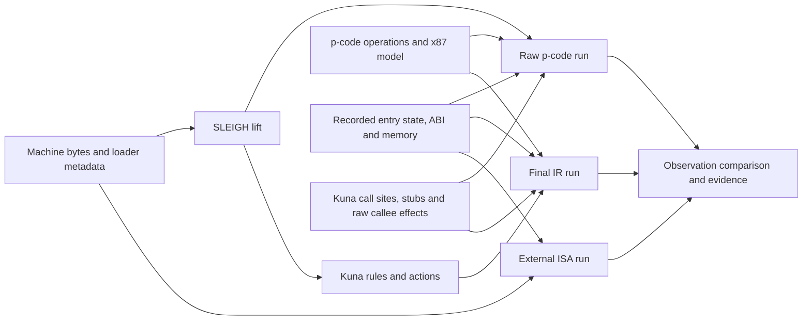

# Independent execution and translation validation

## Audit at PR #1830

Reference commit `16aedb04a358949c3918309ad4d1ed8c61a91240`. The final IR is
`Funcdata` after the decompiler schedule. Tier C compares it with raw p-code
from the loaded image on sampled states. Tier L has a separate single-instruction
Unicorn runner. This roadmap starts on a follow-up branch.



| Dependency | Current consumer | Consequence for validation |
|---|---|---|
| Image bytes, loader overlays, entry locations and tracked context | `session.rs`, `state/mod.rs`, `machine/mod.rs` and the decompiler | Common loader or launch errors can survive Tier C. E1 records image identity, mapped bytes and relocation assumptions. Exported bytes can be checked against the original image independently. |
| SLEIGH language, context, register layout and p-code op definitions | Raw lift and the IR from which `graph/program.rs` compiles | A wrong lift can be preserved through later rules. The external runner consumes bytes and named architectural state. |
| `semantics/value.rs`, `x87.rs`, user-op values and storage translation | Both interpreters | A shared implementation defect can agree on every input. Raw and IR remain separate producers of observations. |
| Initial state, lazy memory, extensions, inferred bool domains, stack and reachable objects | `compare/setup.rs`, `state/mod.rs`, `abi/mod.rs` | Both may execute a state chosen using recovery assumptions. E1 accepts an explicit map fixed before any run. Unmapped data stays unmapped. |
| Call targets and prototypes, calling-convention storage, preserve sets, no-return evidence and recognized user ops | `abi/calls.rs`, `machine/mod.rs`, `graph/mod.rs` | Address and model mistakes can reach both paths. The initial external backend stops at environmental boundaries and reports the physical argument state there. Native or emulated call summaries require separate justification. |
| Recorded callee effects and shared stub semantics | `machine/mod.rs`, `graph/mod.rs`, `State::call` | IR execution can replay the raw side's register and memory effects. The comparison must disclose which callees were replayed or stubbed. |
| Which results count, their ABI interpretation, and declared divergences | `compare/check.rs`, `observe.rs`, `returns.rs`, `abi/divergence.rs` | A match covers only the named observations. Preserve prefix checks and existing verdict labels. Caller-owned stack, printed C and unmodeled external effects have separate coverage limits. |
| Concolic input generation | `tools/concolic.rs` | The worklist explores concrete raw paths and can concretize an unsupported op. Reuse bit-vector expressions and SMT serialization after reviewing operations and trap guards. A path search cannot discharge an equivalence obligation. |
| Mutation selection | `tools/mutate.rs` | Most changes target final IR or graph call facts. The no-return mutant also changes the machine's call claim. Report reached, caught, inconclusive and missed separately. Add faults in shared dependencies to measure the independent runner's added detection. |
| Tier L instruction and memory selection | `tools/step.rs`, `scripts/diffverify/tier_l.py` | It starts from a raw-p-code instruction sample and maps the bytes that execution read. E1 can reuse the optional Unicorn dependency and architectural register mapping. It needs a separately declared function memory map. |

Unicorn uses QEMU's TCG lineage. Agreement between them cannot establish two
independent ISA semantics. The two p-code executions also share a semantic
family even when they run different instruction graphs.

## Reference measurements

Build the pinned checkout's `kuna-verify` before changing either interpreter.
Freeze that executable and use the same seed, inputs, spec build and verdict
grouping on both sides of later comparisons. Keep timeouts, failed loads and
unsupported cases in the denominators or report them as a separate count.

```sh
make test test-stages check-spec
K=decompiler/target/release/kuna-verify
"$K" corpus tests/datatests tests/stages --runs 256 --seed 0x6b756e61 --jobs 4 \
  --json --save-baseline verdicts.json > corpus.jsonl
"$K" mutate tests/datatests tests/stages --runs 32 --seed 0x6b756e61 \
  --per-function 6 --jobs 3 --json > mutations.jsonl
```

The real-image control set is DecBench `O0/coreutils/ls`, `O2/coreutils/ls`
and `O2/findutils/find` at dataset revision
`815eb96f130b6d2ef7fa600e04669bf20139bf27`. Run each with
`check BINARY --all --runs 256 --seed 0x6b756e61 --jobs 1 --json`. Keep the
function inventory and order, including repeated names. The 32-run mutation
baseline has its own sampling budget and cannot be compared directly with
the published default-budget results.

The reference build used rustc 1.100.0. The datatests and stage tests
matched their baselines at 675/675 and 5,580/5,580. The spec check passed.

| Input | Functions | AGREES | DIFFERS | DIVERGES | UNKNOWN |
|---|---:|---:|---:|---:|---:|
| Datatests and stages (940 files) | 5,079 | 4,375 | 115 | 29 | 560 |
| DecBench O0 coreutils `ls` | 590 | 556 | 5 | 0 | 29 |
| DecBench O2 coreutils `ls` | 405 | 381 | 1 | 0 | 23 |
| DecBench O2 findutils `find` | 659 | 628 | 1 | 0 | 30 |

The corpus also emitted one file error for `kuna-aif-slot-edges`. The
mutation run attempted 19,047 mutants and reached 18,074. It caught 13,554
of those (74.99%) and reported 1,541 as inconclusive.

## Milestone acceptance

| Milestone | Deliverable | Evidence required before proceeding |
|---|---|---|
| E1 | Function-level Unicorn executor for x86-64. A versioned input describes raw mapped bytes, launch state, bounds and modeled boundaries. The same contract can admit other execution backends. | Reproducible multi-instruction fixtures compared with both existing engines. Include a return, a bounded loop, memory effects, a preserved-register violation and an environmental stop. Unmapped or unsupported instructions produce incomplete evidence. |
| E2 | Three observations with backend and semantic-dependency provenance, independent of the existing verdict. | Compare every named observable, replay mismatches from saved cases, and test a fault shared by both p-code paths. Classify candidate causes and retain incomplete prefixes. |
| S1 | Independently constructed raw and final symbolic states, then a QF_BV translation-validation obligation. | Check precondition satisfiability separately. Validate width, signed comparisons, Boolean values, shifts, carries and traps. Replay SAT witnesses. Associate UNSAT with the exact obligation and record unsupported operations, solver errors and timeouts. |
| S2 | Byte-addressable symbolic memory, covering acyclic CFGs with differing branch structures and SSA joins. | Equivalent fixtures with dissimilar CFGs, aliasing and endian controls, explicit target sets, and tests for undefined behavior, path coverage and unmodeled calls. |
| S3 | Bounded loops, step and recursion limits, plus coverage evidence. | Tests where exit within the bound differs, both sides reach a bound, or paths remain unexplored. Preserve the bounds in each reported result. |
| S4 | Cutpoints and compositional summaries, then inductive loop obligations. | Check invariant initiation, inductiveness and observable exit equivalence separately. Scope any unrestricted result to paths proven covered. |
| F1 | Independent formal RISC-V integer semantics with explicit observation projection. | Compare formal ISA to raw p-code and raw p-code to final IR. Compose only under compatible domains, state mappings and observables. Document unsupported instructions and the trusted computing base. |
| F2 | Reproducible obligations, witnesses and independently checkable proof artifacts where practical. | Archive inputs, bounds, backend and solver versions, proof checker dependencies and exact obligations. Recheck artifacts outside the producing verifier. |

Verdict resolution belongs at the observation boundary. A confirmed mismatch
outranks a declared divergence. An unfinished prefix, incomplete call replay or
unsupported path limits the assurance. Report sampled agreement, cross-backend
agreement, bounded equivalence, model equivalence and certified equivalence at
their own strengths. Report counterexamples, declared divergences and
inconclusive results separately from those agreement levels.

For each milestone, retain the exact input and runtime configuration with any
witness. Measure coverage, disagreement, false positives and false negatives
on independently labeled controls, reproducibility, mutation recall, proof
completion, solver timeouts, wall time and peak memory. Publish results by
architecture, toolchain, optimization level and function complexity alongside
each tier's eligibility and exclusions.
